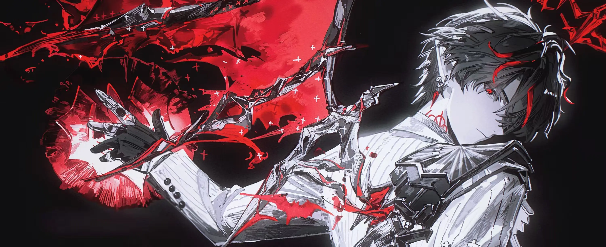
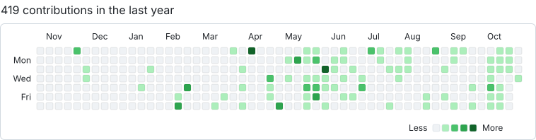

    
    
    
    
    
    
    
    
    
    

👋你好！我是刃律。很高兴遇见你。

👋Hi, I'm RenAhsAcme. Nice to meet you!

## 当前关注 Current Focus

开源社区开发。编程语言综合学习。智能应用与系统安全，如具身智能安全、人工智能安全应用等；面向安全的人工智能模型设计。

Open source community development. Comprehensive learning of programming languages. Intelligent application and system security, such as embodied intelligence security, AI security applications, etc.; security-oriented AI model design.

## 联系方式 Contact

[Email](mailto:searing-fiestas-8l@icloud.com)

<picture>
  <source media="(prefers-color-scheme: dark)" srcset="assets/contributions-dark.svg">
  
</picture>

